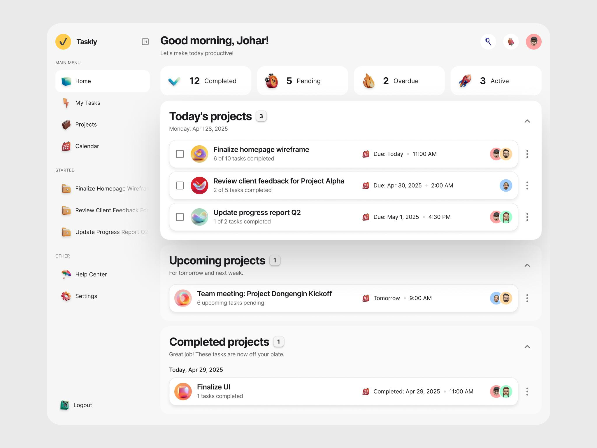
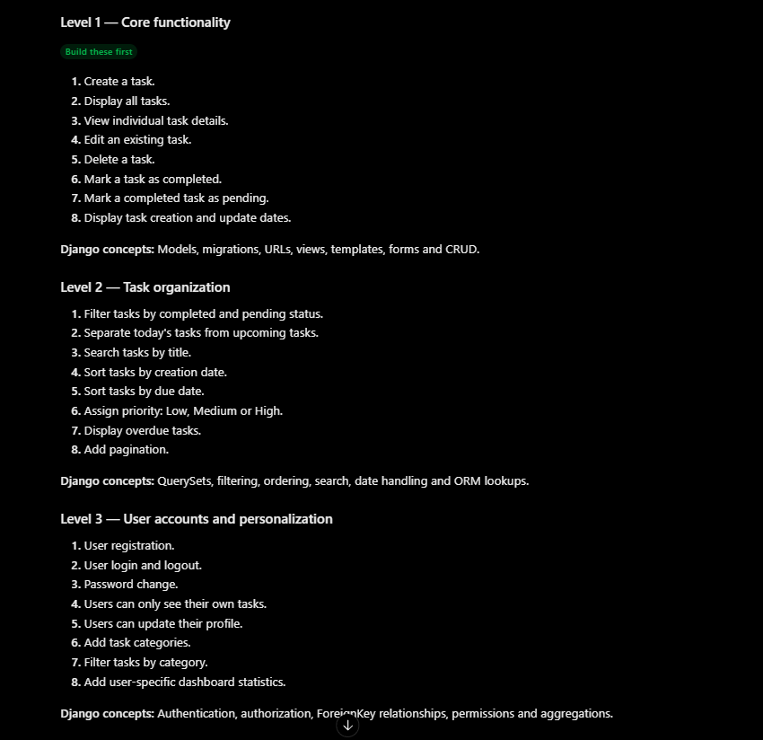
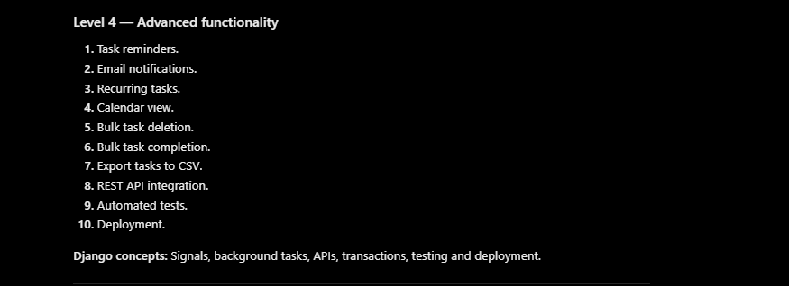
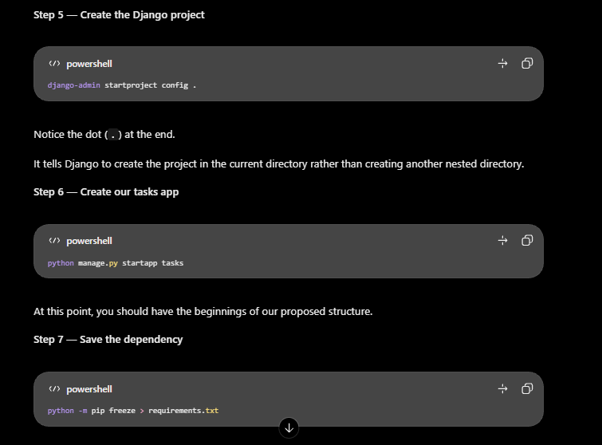

# Todo List Application

## Project Overview

A Django-based Todo List application developed incrementally to practise Django concepts and software engineering principles.

## Technology Stack

- Python
- Django
- SQLite
- HTML
- CSS

## Project Structure

The project follows a modular Django structure, separating project configuration from application functionality.

### Project Structure Overview

## Development Stages

### Level 1 — Core Todo Functionality

- [ ] Project initialization
- [ ] Django configuration
- [ ] Tasks application setup
- [ ] Database model
- [ ] CRUD functionality

### Level 2 — Task Management Improvements

- [ ] Task search
- [ ] Task filtering
- [ ] Task sorting
- [ ] Priority management
- [ ] Due dates and overdue tracking

### Level 3 — Authentication and User Management

- [ ] User registration
- [ ] Login and logout
- [ ] User-specific tasks
- [ ] Access control

### Level 4 — Advanced Features

- [ ] Notifications and reminders
- [ ] Recurring tasks
- [ ] Calendar view
- [ ] REST API
- [ ] Automated testing
- [ ] Deployment

## Technical Notes

Important concepts, architectural decisions, implementation notes, and lessons learned.

### Environment Configuration

- Environment variables managed with `django-environ`.
- Local secrets stored in `.env`.
- `.env.example` documents required variables.
- Sensitive files excluded through `.gitignore`.
- Production configuration will use hosting-provider environment variables.

## Setup Instructions

Instructions for installing dependencies, configuring the environment, and running the project.
