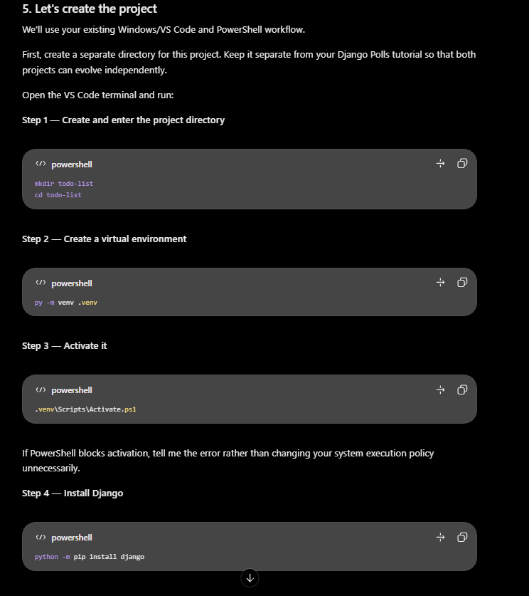

<!-- 
# Todo List Application

## Project Overview

A Django-based Todo List application developed incrementally to practise Django concepts and software engineering principles.

## Technology Stack

- Python
- Django
- SQLite
- HTML
- CSS

## Project Structure

The project follows a modular Django structure, separating project configuration from application functionality.

### Project Structure Overview


## Development Stages

### Level 1 — Core Todo Functionality

- [x] Project initialization
- [x] Django configuration
- [x] Tasks application setup
- [x] Database model


### Database Design

#### Task Entity

| Field | Data Type | Description |
|---|---|---|
| id | BigAutoField | Primary key |
| title | CharField | Task title |
| description | TextField | Optional description |
| completed | BooleanField | Completion status |
| priority | CharField | Task priority |
| due_date | DateField | Optional deadline |
| created_at | DateTimeField | Creation timestamp |
| updated_at | DateTimeField | Last update timestamp |

#### Design Decisions

- Tasks begin with a pending status.
- Task descriptions are optional.
- Due dates are optional.
- Priority defaults to Medium.
- User ownership will be introduced in Level 3.

### Database Migrations

- Task model defined in `tasks/models.py`.
- Initial migration generated using `makemigrations`.
- Migration operations reviewed before application.
- Migration applied using `migrate`.


- [ ] CRUD functionality

### Level 2 — Task Management Improvements

- [ ] Task search
- [ ] Task filtering
- [ ] Task sorting
- [ ] Priority management
- [ ] Due dates and overdue tracking

### Level 3 — Authentication and User Management

- [ ] User registration
- [ ] Login and logout
- [ ] User-specific tasks
- [ ] Access control

### Level 4 — Advanced Features

- [ ] Notifications and reminders
- [ ] Recurring tasks
- [ ] Calendar view
- [ ] REST API
- [ ] Automated testing
- [ ] Deployment

## Technical Notes

Important concepts, architectural decisions, implementation notes, and lessons learned.

### Environment Configuration

- Environment variables managed with `django-environ`.
- Local secrets stored in `.env`.
- `.env.example` documents required variables.
- Sensitive files excluded through `.gitignore`.
- Production configuration will use hosting-provider environment variables.

## Setup Instructions

Instructions for installing dependencies, configuring the environment, and running the project.




## Project Tree


todo-list/
│
├── .venv/
│
├── config/
│   ├── __init__.py
│   ├── settings.py
│   ├── urls.py
│   ├── asgi.py
│   └── wsgi.py
│
├── tasks/
│   ├── migrations/
│   │   └── __init__.py
│   │
│   ├── templates/
│   │   └── tasks/
│   │       ├── base.html
│   │       ├── task_list.html
│   │       ├── task_detail.html
│   │       ├── task_form.html
│   │       └── task_confirm_delete.html
│   │
│   ├── static/
│   │   └── tasks/
│   │       └── css/
│   │           └── style.css
│   │
│   ├── __init__.py
│   ├── admin.py
│   ├── apps.py
│   ├── models.py
│   ├── tests.py
│   ├── views.py
│   ├── urls.py
│   └── forms.py
│
├── .gitignore
├── db.sqlite3
├── manage.py
├── requirements.txt
└── README.md


Okay understand and implemented, let's proceed  to the next stage on Level 1 why keeping the engineering intact -->


# TaskFlow — Django Todo List Application

A task management application built with Python and Django. This project is being developed incrementally to practise Django fundamentals, application architecture, form handling, database operations, and software engineering principles.

## Technology Stack

- **Backend:** Python, Django
- **Database:** SQLite
- **Frontend:** HTML, CSS
- **Forms:** Django ModelForms
- **Testing:** Django Test Framework
- **Environment:** Python virtual environment, environment variables

## Project Structure

The application separates project configuration from task-related functionality.

```text
todo-list/
├── config/
│   ├── settings.py
│   ├── urls.py
│   ├── asgi.py
│   └── wsgi.py
├── tasks/
│   ├── migrations/
│   ├── templates/
│   │   └── tasks/
│   │       ├── base.html
│   │       ├── task_list.html
│   │       ├── task_detail.html
│   │       ├── task_form.html
│   │       └── task_confirm_delete.html
│   ├── static/
│   │   └── tasks/
│   │       └── css/
│   │           └── style.css
│   ├── admin.py
│   ├── apps.py
│   ├── forms.py
│   ├── models.py
│   ├── tests.py
│   ├── urls.py
│   └── views.py
├── docs/
│   └── images/
├── .env.example
├── .gitignore
├── manage.py
├── requirements.txt
└── README.md
```

## Application Features

### Level 1 — Core Todo Functionality

- [x] Django project initialization and configuration
- [x] Tasks application setup
- [x] Environment variable configuration
- [x] Task database model and migrations
- [x] Django admin registration
- [x] Create tasks
- [x] View all tasks
- [x] View individual task details
- [x] Update existing tasks
- [x] Delete tasks with confirmation
- [x] Mark tasks as completed or pending
- [x] Task priority levels: Low, Medium, High
- [x] Optional task descriptions and deadlines
- [x] Automatic creation and update timestamps
- [x] Django ModelForm validation
- [x] Responsive dashboard interface
- [x] Reusable Django templates
- [x] Basic model and view testing

### Level 2 — Task Management Improvements

- [ ] Task search
- [ ] Task filtering
- [ ] Task sorting
- [ ] Completed and pending views
- [ ] Today and upcoming tasks
- [ ] Overdue task tracking
- [ ] Pagination
- [ ] Improved dashboard statistics

### Level 3 — Authentication and User Management

- [ ] User registration
- [ ] Login and logout
- [ ] User-specific tasks
- [ ] Task ownership and access control
- [ ] Categories
- [ ] User-specific dashboard statistics

### Level 4 — Advanced Features

- [ ] Reminders and email notifications
- [ ] Recurring tasks
- [ ] Calendar view
- [ ] Bulk task actions
- [ ] CSV export
- [ ] REST API
- [ ] Expanded automated tests
- [ ] Deployment

## Screenshots

Store project screenshots in `docs/images/`.

Add screenshots as the interface develops:

```markdown


```

## Setup Instructions

### 1. Clone the repository

```bash
git clone <repository-url>
cd todo-list
```

### 2. Create and activate a virtual environment

Windows PowerShell:

```powershell
py -m venv .venv
.venv\Scripts\Activate.ps1
```

### 3. Install dependencies

```bash
python -m pip install -r requirements.txt
```

### 4. Configure environment variables

Create a `.env` file in the project root using `.env.example` as a reference.

Set the required values:

```env
SECRET_KEY=your-secret-key
DEBUG=True
ALLOWED_HOSTS=localhost,127.0.0.1
```

Generate a Django secret key locally. Do not commit the actual `.env` file.

### 5. Apply database migrations

```bash
python manage.py migrate
```

### 6. Run the development server

```bash
python manage.py runserver
```

Open:

```text
http://127.0.0.1:8000/tasks/
```

### 7. Run tests

```bash
python manage.py test tasks
```

## Technical Notes

- Django project configuration is maintained in `config/`.
- The `tasks` application contains the task domain functionality.
- Django ModelForms handle form rendering and server-side validation.
- Named URL patterns and the `tasks` namespace are used for URL resolution.
- Task-changing actions use POST requests.
- Templates use inheritance to share the application layout.
- Environment variables keep local configuration and secrets outside the source code.
- SQLite is used during development.

## Development Approach

This project follows an incremental, documentation-first learning approach. Each development level introduces new Django concepts and practical implementation tasks.

The objective is to understand the reasoning behind implementation decisions, not simply produce working code.