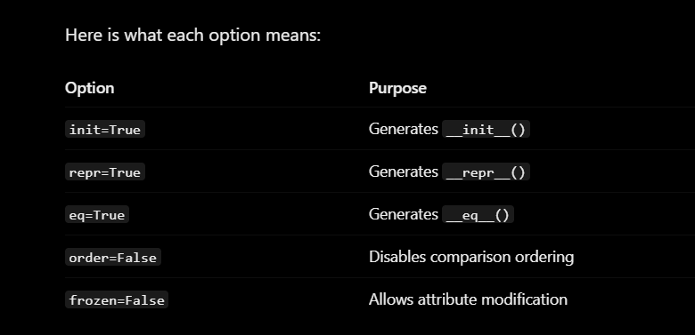

# Django Project Roadmap: Beginner to Advanced

### Beginner Projects

1. Todo List Application
2. Personal Notes Application
3. Personal Blog Application
4. Student Record Management System

### Intermediate Projects

5. Personal Expense Tracker
6. Library Management System
7. Inventory Management System
8. Appointment Booking System

### Advanced Beginner / API Development

9. REST API for a Task Management System
10. E-commerce Application

### Advanced Projects

11. Project Management Platform
12. Customer Relationship Management (CRM) System

Recommended learning order: Complete them sequentially, starting with Todo List.

Each project should progressively strengthen your understanding of:

- Django project and application structure.
- Models, migrations and database relationships.
- Function-based and class-based views.
- URL routing and namespaces.
- Templates, forms and validation.
- Authentication and authorization.
- Django ORM and complex queries.
- Modular application architecture.
- REST APIs and integrations.
- Testing, security and deployment.

My advice: Don't rush to the next project. Complete the core functionality, write tests, document the architecture and understand your implementation before moving forward.